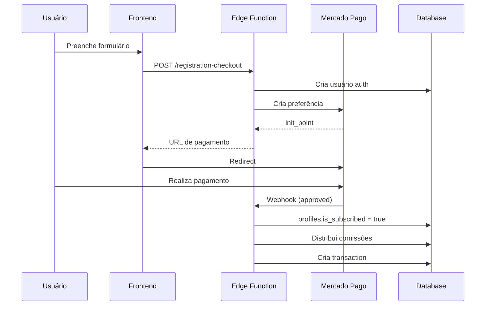
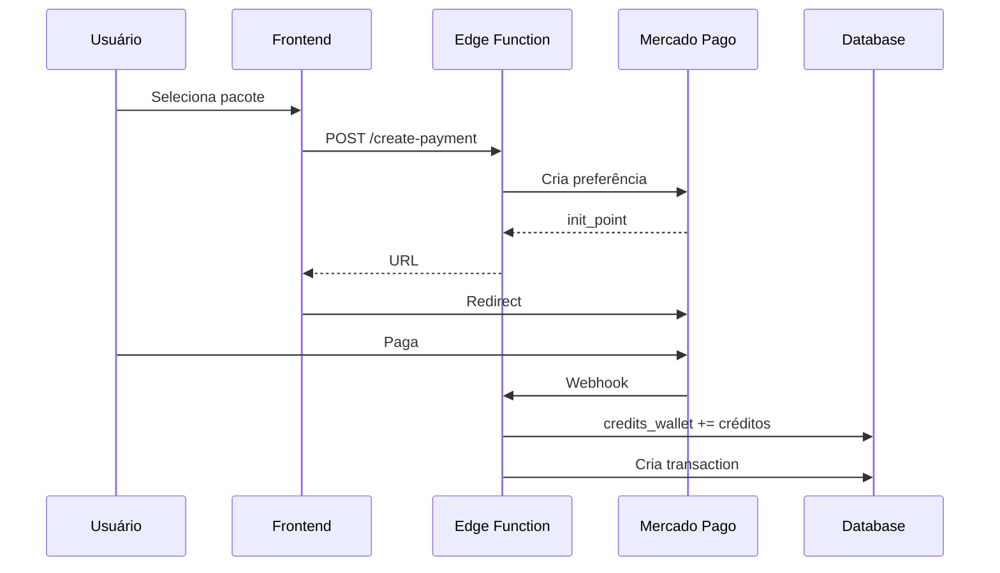
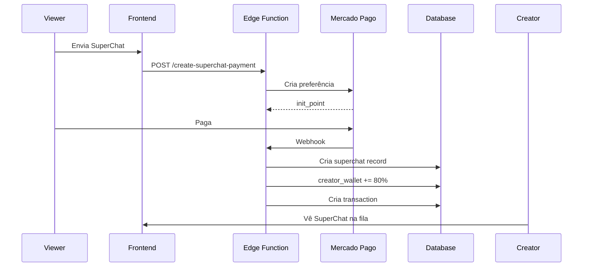

# 📊 Stream Star - Documentação Técnica das APIs Financeiras

Este documento detalha todas as APIs financeiras implementadas no Stream Star, incluindo fluxos de pagamento, estrutura de dados e guia para replicação em Stripe.

---

## 📋 Índice

1. [Visão Geral da Arquitetura](#1-visão-geral-da-arquitetura)
2. [Edge Functions](#2-edge-functions)
3. [Fluxos de Pagamento](#3-fluxos-de-pagamento)
4. [Estrutura do Banco de Dados](#4-estrutura-do-banco-de-dados)
5. [Webhooks e Processamento](#5-webhooks-e-processamento)
6. [Guia de Replicação para Stripe](#6-guia-de-replicação-para-stripe)

---

## 1. Visão Geral da Arquitetura

```
┌─────────────────┐     ┌──────────────────┐     ┌─────────────────┐
│    Frontend     │────▶│  Edge Functions  │────▶│  Mercado Pago   │
│  (React/Vite)   │     │   (Supabase)     │     │      API        │
└─────────────────┘     └──────────────────┘     └─────────────────┘
                               │                         │
                               ▼                         │
                        ┌──────────────┐                 │
                        │   Supabase   │◀────────────────┘
                        │   Database   │    (Webhook)
                        └──────────────┘
```

### Secrets Necessários

| Secret | Descrição | Onde Obter |
|--------|-----------|------------|
| `MERCADOPAGO_ACCESS_TOKEN` | Token de acesso da API | Painel MP → Credenciais |
| `MERCADOPAGO_PUBLIC_KEY` | Chave pública | Painel MP → Credenciais |
| `MERCADOPAGO_WEBHOOK_SECRET` | Assinatura webhook | Painel MP → Webhooks |

---

## 2. Edge Functions

### 2.1 `registration-checkout`

**Endpoint:** `POST /functions/v1/registration-checkout`

**Propósito:** Criar conta de usuário e iniciar pagamento de ativação.

**Request Body:**
```json
{
  "fullName": "string",
  "email": "string",
  "password": "string",
  "referralCode": "string | null",
  "acceptTerms": true,
  "free": false,
  "root": false
}
```

**Response (Pagamento Necessário):**
```json
{
  "init_point": "https://www.mercadopago.com.br/checkout/...",
  "preferenceId": "uuid",
  "paymentId": "uuid",
  "amount": 5.00
}
```

**Response (Registro Gratuito):**
```json
{
  "status": "active",
  "profileId": "uuid",
  "token": "jwt_access_token",
  "refresh_token": "jwt_refresh_token"
}
```

**Lógica de Negócio:**
- Valida código de indicação
- Cria usuário no Supabase Auth
- Se `free=true` ou `root=true`: ativa imediatamente
- Senão: cria preferência Mercado Pago (R$ 5,00)

---

### 2.2 `create-payment`

**Endpoint:** `POST /functions/v1/create-payment`

**Propósito:** Criar pagamento para compra de créditos ou acesso a live.

**Request Body:**
```json
{
  "userId": "uuid",
  "purchaseType": "credits | live_access",
  "credits": 180,
  "liveId": "uuid | null",
  "amount": null,
  "description": null
}
```

**Pacotes de Créditos:**
| Créditos | Preço (BRL) | Tempo Equivalente |
|----------|-------------|-------------------|
| 180 | R$ 5,00 | 30 minutos |
| 360 | R$ 9,00 | 1 hora |
| 720 | R$ 16,00 | 2 horas |
| 1800 | R$ 35,00 | 5 horas |

**Response:**
```json
{
  "init_point": "https://www.mercadopago.com.br/checkout/...",
  "preferenceId": "uuid",
  "paymentId": "uuid",
  "amount": 5.00,
  "credits": 180
}
```

---

### 2.3 `create-superchat-payment`

**Endpoint:** `POST /functions/v1/create-superchat-payment`

**Propósito:** Criar pagamento para SuperChat durante live.

**Request Body:**
```json
{
  "userId": "uuid",
  "creatorId": "uuid",
  "roomId": "uuid",
  "tier": "blue | yellow | red",
  "message": "string"
}
```

**Tiers de SuperChat:**
| Tier | Preço | Duração | Cor |
|------|-------|---------|-----|
| Blue | R$ 3,00 | 60s | Azul |
| Yellow | R$ 5,00 | 120s | Amarelo |
| Red | R$ 8,00 | 180s | Vermelho |

**Response:**
```json
{
  "init_point": "https://...",
  "preferenceId": "uuid",
  "paymentId": "uuid",
  "amount": 3.00,
  "tier": "blue",
  "duration": 60
}
```

---

### 2.4 `pix-withdraw`

**Endpoint:** `POST /functions/v1/pix-withdraw`

**Propósito:** Solicitar saque via PIX.

**Request Body:**
```json
{
  "userId": "uuid",
  "pixKey": "string",
  "pixKeyType": "cpf | cnpj | email | phone | random",
  "amountCents": 1000,
  "isCreator": true
}
```

**Validações:**
- Mínimo: R$ 10,00 (1000 centavos)
- Verifica saldo disponível
- Tipos de chave PIX suportados

**Response:**
```json
{
  "success": true,
  "status": "pending_approval",
  "message": "Solicitação de saque enviada para aprovação",
  "payoutId": "uuid",
  "amount": 10.00,
  "fee": 0,
  "netAmount": 10.00,
  "estimatedTime": "24-48 horas úteis"
}
```

---

### 2.5 `process-pix-payout` (Admin Only)

**Endpoint:** `POST /functions/v1/process-pix-payout`

**Propósito:** Processar solicitações de saque (aprovar/rejeitar/completar).

**Request Body:**
```json
{
  "payoutId": "uuid",
  "action": "approve | complete | reject",
  "transactionId": "string | null",
  "notes": "string | null"
}
```

**Actions:**
- `approve`: Marca como aprovado (pronto para transferência manual)
- `complete`: Marca como pago (após transferência PIX)
- `reject`: Rejeita e devolve saldo ao usuário

---

### 2.6 `mercadopago-webhook`

**Endpoint:** `POST /functions/v1/mercadopago-webhook`

**Propósito:** Receber e processar notificações de pagamento do Mercado Pago.

**Event Types Processados:**
- `REGISTRATION` - Ativação de conta
- `CREDITS_PURCHASE` - Compra de créditos
- `LIVE_ACCESS` - Acesso a live
- `SUPERCHAT` - SuperChat

**Fluxo de Processamento:**
```
1. Recebe webhook do MP
2. Busca detalhes do pagamento via API MP
3. Verifica status = 'approved'
4. Verifica idempotência (evita duplicatas)
5. Processa baseado no event_type
6. Atualiza banco de dados
7. Notifica admins
```

---

## 3. Fluxos de Pagamento

### 3.1 Fluxo de Cadastro Pago



### 3.2 Distribuição de Comissões (Cadastro)

```
Valor: R$ 5,00

┌─────────────────────────────────────┐
│ Referenciador Direto (Pai): R$ 1,00 │
├─────────────────────────────────────┤
│ Referenciador Raiz (Avô):  R$ 0,50  │
├─────────────────────────────────────┤
│ Plataforma:                R$ 3,50  │
└─────────────────────────────────────┘
```

### 3.3 Fluxo de Compra de Créditos



### 3.4 Fluxo de SuperChat



### 3.5 Revenue Split (Lives e SuperChats)

```
┌──────────────────────────────────┐
│         Receita Bruta            │
└──────────────────────────────────┘
              │
              ▼
┌──────────────────────────────────┐
│  80% → Creator (creator_wallet)  │
├──────────────────────────────────┤
│  20% → Plataforma                │
└──────────────────────────────────┘
```

---

## 4. Estrutura do Banco de Dados

### 4.1 Tabelas Financeiras

```sql
-- Transações gerais
CREATE TABLE transactions (
  id UUID PRIMARY KEY,
  user_id UUID,
  creator_id UUID,
  affiliate_id UUID,
  type TEXT NOT NULL, -- 'registration', 'credits_purchase', 'superchat', 'live_access', 'pix_withdraw'
  amount NUMERIC NOT NULL,
  platform_amount NUMERIC,
  creator_amount NUMERIC,
  affiliate_amount NUMERIC,
  status TEXT DEFAULT 'pending',
  payment_method TEXT,
  external_id TEXT,
  metadata JSONB,
  created_at TIMESTAMPTZ DEFAULT NOW()
);

-- Carteira de créditos do usuário
CREATE TABLE credits_wallet (
  id UUID PRIMARY KEY,
  user_id UUID NOT NULL UNIQUE,
  balance_credits INTEGER DEFAULT 0,
  created_at TIMESTAMPTZ DEFAULT NOW(),
  updated_at TIMESTAMPTZ DEFAULT NOW()
);

-- Carteira do criador (em centavos)
CREATE TABLE creator_wallet (
  id UUID PRIMARY KEY,
  creator_id UUID NOT NULL UNIQUE,
  balance_cents INTEGER DEFAULT 0,
  pending_cents INTEGER DEFAULT 0,
  total_earned_cents INTEGER DEFAULT 0,
  created_at TIMESTAMPTZ DEFAULT NOW(),
  updated_at TIMESTAMPTZ DEFAULT NOW()
);

-- Solicitações de saque
CREATE TABLE payout_requests (
  id UUID PRIMARY KEY,
  creator_id UUID NOT NULL,
  amount NUMERIC NOT NULL,
  status TEXT DEFAULT 'pending', -- 'pending', 'approved', 'paid', 'rejected'
  bank_account_id UUID,
  approved_by UUID,
  approved_at TIMESTAMPTZ,
  paid_at TIMESTAMPTZ,
  admin_notes TEXT, -- JSON com detalhes PIX
  created_at TIMESTAMPTZ DEFAULT NOW()
);

-- Log de comissões de afiliados
CREATE TABLE affiliate_logs (
  id UUID PRIMARY KEY,
  new_user UUID,
  direct_referrer UUID,
  root_creator UUID,
  amount_direct INTEGER DEFAULT 0,
  amount_root INTEGER DEFAULT 0,
  amount_platform INTEGER DEFAULT 0,
  event_type TEXT NOT NULL,
  payment_id TEXT,
  created_at TIMESTAMPTZ DEFAULT NOW()
);
```

### 4.2 Funções RPC

```sql
-- Incrementar saldo do criador
CREATE FUNCTION increment_creator_wallet(p_creator_id UUID, p_amount_cents INTEGER)
RETURNS VOID AS $$
BEGIN
  INSERT INTO creator_wallet (creator_id, balance_cents, total_earned_cents)
  VALUES (p_creator_id, p_amount_cents, p_amount_cents)
  ON CONFLICT (creator_id) DO UPDATE SET
    balance_cents = creator_wallet.balance_cents + p_amount_cents,
    total_earned_cents = creator_wallet.total_earned_cents + p_amount_cents,
    updated_at = NOW();
END;
$$ LANGUAGE plpgsql SECURITY DEFINER;

-- Incrementar earnings de afiliado
CREATE FUNCTION increment_affiliate_earnings(p_profile_id UUID, p_amount_cents INTEGER)
RETURNS VOID AS $$
BEGIN
  UPDATE profiles
  SET affiliate_earnings = COALESCE(affiliate_earnings, 0) + p_amount_cents,
      updated_at = NOW()
  WHERE id = p_profile_id;
END;
$$ LANGUAGE plpgsql SECURITY DEFINER;
```

---

## 5. Webhooks e Processamento

### 5.1 Configuração do Webhook Mercado Pago

**URL:** `https://[PROJECT_ID].supabase.co/functions/v1/mercadopago-webhook`

**Eventos:** `payment.created`, `payment.updated`

### 5.2 Verificação de Assinatura (Recomendado)

```typescript
import crypto from 'crypto';

function verifyMercadoPagoSignature(
  payload: string,
  signature: string,
  secret: string
): boolean {
  const [ts, v1] = signature.split(',').map(s => s.split('=')[1]);
  const manifest = `id:${payload};request-id:${requestId};ts:${ts};`;
  const hmac = crypto.createHmac('sha256', secret).update(manifest).digest('hex');
  return hmac === v1;
}
```

### 5.3 Idempotência

O webhook verifica duplicatas usando `external_id` na tabela `transactions`:

```typescript
const { data: existing } = await supabase
  .from('transactions')
  .select('id')
  .eq('external_id', externalRef)
  .maybeSingle();

if (existing) {
  return { success: true, duplicate: true };
}
```

---

## 6. Guia de Replicação para Stripe

### 6.1 Mapeamento de Conceitos

| Mercado Pago | Stripe | Descrição |
|--------------|--------|-----------|
| Preference | Checkout Session | Sessão de pagamento |
| Payment | PaymentIntent | Intenção de pagamento |
| Access Token | Secret Key | Chave de API |
| Public Key | Publishable Key | Chave pública |
| Webhook notification | Webhook event | Evento de webhook |
| PIX | - | Não disponível (usar bank transfer) |

### 6.2 Código Equivalente

#### Criar Checkout Session (Stripe)

```typescript
// Stripe equivalente ao create-payment
import Stripe from 'stripe';

const stripe = new Stripe(process.env.STRIPE_SECRET_KEY);

async function createCheckoutSession(userId: string, credits: number) {
  const prices = {
    180: 'price_xxxxx180', // Criar no Stripe Dashboard
    360: 'price_xxxxx360',
    720: 'price_xxxxx720',
    1800: 'price_xxxxx1800',
  };

  const session = await stripe.checkout.sessions.create({
    payment_method_types: ['card'],
    line_items: [{
      price: prices[credits],
      quantity: 1,
    }],
    mode: 'payment',
    success_url: `${origin}/dashboard?success=true`,
    cancel_url: `${origin}/dashboard?canceled=true`,
    metadata: {
      event_type: 'CREDITS_PURCHASE',
      user_id: userId,
      credits: credits.toString(),
    },
  });

  return {
    url: session.url,
    sessionId: session.id,
  };
}
```

#### Webhook Handler (Stripe)

```typescript
// Stripe equivalente ao mercadopago-webhook
import Stripe from 'stripe';

const stripe = new Stripe(process.env.STRIPE_SECRET_KEY);

async function handleStripeWebhook(req: Request) {
  const sig = req.headers.get('stripe-signature');
  const body = await req.text();
  
  const event = stripe.webhooks.constructEvent(
    body,
    sig,
    process.env.STRIPE_WEBHOOK_SECRET
  );

  if (event.type === 'checkout.session.completed') {
    const session = event.data.object as Stripe.Checkout.Session;
    const metadata = session.metadata;
    
    if (metadata.event_type === 'CREDITS_PURCHASE') {
      // Mesmo processamento do MP webhook
      await addCreditsToUser(metadata.user_id, parseInt(metadata.credits));
    }
  }

  return { received: true };
}
```

#### Transferências/Payouts (Stripe Connect)

```typescript
// Stripe Connect para pagamentos a criadores
// Requer: Criadores registrados como Connected Accounts

// 1. Criar Connected Account para criador
const account = await stripe.accounts.create({
  type: 'express',
  country: 'BR',
  email: 'creator@example.com',
  capabilities: {
    transfers: { requested: true },
  },
});

// 2. Transferir para criador (equivalente ao saque)
const transfer = await stripe.transfers.create({
  amount: 1000, // centavos
  currency: 'brl',
  destination: account.id,
  metadata: {
    payout_id: 'uuid',
    creator_id: 'uuid',
  },
});

// 3. Payout automático (Stripe gerencia)
// Ou manual via:
const payout = await stripe.payouts.create({
  amount: 1000,
  currency: 'brl',
}, {
  stripeAccount: account.id,
});
```

### 6.3 Estrutura de Arquivos Stripe

```
supabase/functions/
├── stripe-checkout/index.ts      # Criar checkout session
├── stripe-webhook/index.ts       # Processar webhooks
├── stripe-connect-onboard/       # Onboarding de criadores
└── stripe-transfer/index.ts      # Transferências para criadores
```

### 6.4 Diferenças Importantes

| Aspecto | Mercado Pago | Stripe |
|---------|--------------|--------|
| PIX | ✅ Nativo | ❌ Não disponível |
| Boleto | ✅ Nativo | ✅ Disponível |
| Split Payment | Manual | ✅ Stripe Connect |
| Payout automático | ❌ Manual | ✅ Automático |
| Marketplace | Básico | ✅ Stripe Connect |
| Taxas Brasil | ~4.99% | ~3.99% + R$0.39 |

### 6.5 Checklist de Migração

- [ ] Criar conta Stripe e configurar credenciais
- [ ] Criar Products/Prices no Stripe Dashboard
- [ ] Implementar `stripe-checkout` edge function
- [ ] Implementar `stripe-webhook` edge function
- [ ] Configurar webhook no Stripe Dashboard
- [ ] Para payouts: implementar Stripe Connect
  - [ ] Onboarding flow para criadores
  - [ ] Verificação de identidade (KYC)
  - [ ] Configuração de bank accounts
- [ ] Testar em modo sandbox
- [ ] Migrar para produção

---

## 📞 Suporte

Para dúvidas sobre a implementação:
- Documentação Mercado Pago: https://www.mercadopago.com.br/developers
- Documentação Stripe: https://stripe.com/docs
- Supabase Edge Functions: https://supabase.com/docs/guides/functions

---

*Documento gerado em: Dezembro 2024*
*Versão: 1.0*
