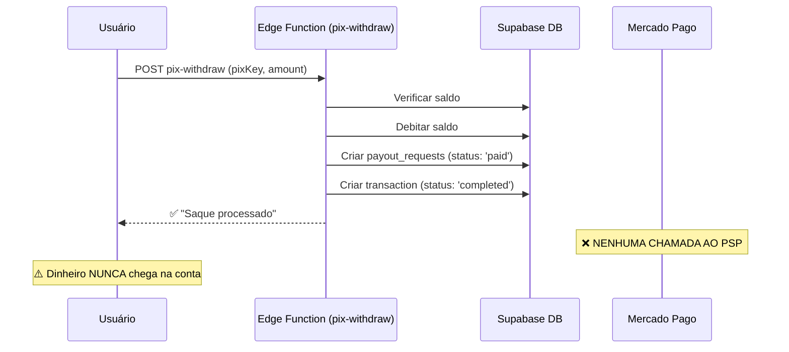
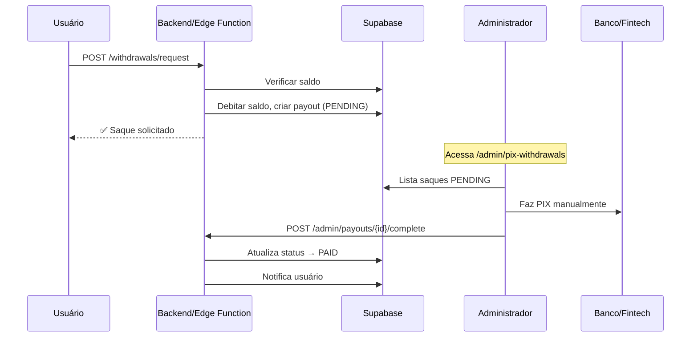
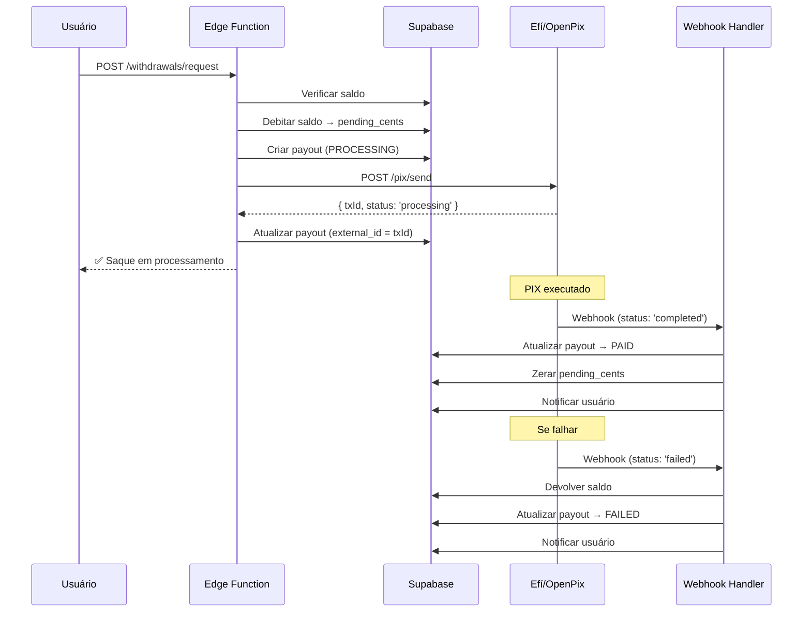

# RELATÓRIO TÉCNICO: SAQUES E WALLET INTERNA

**Projeto:** Stream Live Hub  
**Data:** 2025-12-09  
**Documento:** Relatório interno de arquitetura

---

## 1. MAPEAMENTO DO ESTADO ATUAL

### 1.1 Tabelas do Supabase

#### Tabelas de Usuários
| Tabela | Descrição | Relevância para Saques |
|--------|-----------|------------------------|
| `profiles` | Perfis de usuário (auth) | `balance` (decimal) = saldo de afiliado em BRL |
| `creators` | Registro de criadores | `user_id` → FK para `profiles.id` |
| `creator_profiles` | Perfil público do criador | Metadados de streaming |
| `user_roles` | Roles (admin/creator/viewer) | Controle de acesso admin |

#### Tabelas de Saldo/Wallet
| Tabela | Descrição | Campos Críticos |
|--------|-----------|-----------------|
| `credits_wallet` | Carteira de créditos do usuário | `user_id`, `balance_credits` (integer) |
| `creator_wallet` | Carteira do criador (earnings) | `creator_id`, `balance_cents`, `pending_cents`, `total_earned_cents` |
| `creator_balance` | **LEGACY** - não usar | `balance` (decimal) |

#### Tabelas de Transações/Registros
| Tabela | Descrição | Campos Críticos |
|--------|-----------|-----------------|
| `transactions` | Histórico geral de transações | `type`, `amount`, `status`, `external_id`, `metadata` |
| `payout_requests` | Solicitações de saque | `creator_id`, `amount`, `status`, `pix_key`, `admin_notes` |
| `credit_purchases` | Compras de créditos | `profile_id`, `credits`, `amount_cents`, `payment_id` |
| `creator_earnings` | Ganhos por live | `creator_id`, `live_id`, `gross_cents`, `net_cents`, `platform_cents` |
| `affiliate_logs` | Log de comissões de afiliados | `direct_referrer`, `root_creator`, `amount_direct`, `amount_root` |
| `platform_revenue` | Receita da plataforma | `source_type`, `amount`, `metadata` |
| `webhook_events` | Idempotência de webhooks | `idempotency_key` |

### 1.2 Arquivos que Tratam Wallet/Pagamentos

#### Backend (Express.js)

```
backend/src/services/
├── creditsWalletService.ts      # Wallet de créditos do usuário
├── creditsService.ts            # Operações de créditos (add/consume)
├── creatorWithdrawalsService.ts # Saques de criadores (creator_wallet)
├── creatorEarningsService.ts    # Settlement de ganhos de lives
├── adminPayoutsService.ts       # Admin: aprovar/rejeitar payouts
├── affiliateService.ts          # Comissões de afiliados
└── mercadoPagoService.ts        # Integração Mercado Pago (recebimentos)
```

```
backend/src/controllers/
├── withdrawalsController.ts     # Endpoints de saque
├── creditsController.ts         # Endpoints de créditos
└── adminPayoutsController.ts    # Endpoints admin de payouts
```

```
backend/src/routes/
├── withdrawalsRoutes.ts         # GET /wallet-summary, POST /request
└── adminRoutes.ts               # Rotas admin
```

#### Edge Functions (Supabase)

```
supabase/functions/
├── pix-withdraw/index.ts           # Saque PIX (auto-aprovado, SEM TRANSFERÊNCIA REAL)
├── process-pix-payout/index.ts     # Admin: processar payout (approve/complete/reject)
├── mercadopago-webhook/index.ts    # Webhook de pagamentos recebidos
├── create-payment/index.ts         # Criar preferência MP
├── credits-balance/index.ts        # Consultar saldo
└── registration-checkout/index.ts  # Checkout de registro
```

#### Frontend

```
src/lib/
├── withdrawalsService.ts        # Service de saques (admin)
├── pixWithdrawalsService.ts     # Service de saques PIX
└── payments.ts                  # Utilitários de pagamento

src/hooks/
├── useWithdrawals.ts            # Hook para admin withdrawals
└── usePixWithdrawals.ts         # Hook para PIX withdrawals

src/components/
├── PixWithdrawDialog.tsx               # Dialog de saque PIX
├── creator/wallet/CreatorWalletPanel.tsx  # Painel de wallet do criador
└── admin/PixWithdrawalsTable.tsx       # Tabela admin de saques

src/pages/
├── AdminPixWithdrawals.tsx      # Página admin de saques PIX
├── AdminWithdrawals.tsx         # Página admin de saques gerais
└── CreatorPayouts.tsx           # Página de payouts do criador
```

### 1.3 Estado Atual da Implementação

#### ✅ JÁ EXISTE

| Recurso | Status | Arquivos |
|---------|--------|----------|
| **Wallet de Créditos (Viewer)** | ✅ Funcional | `credits_wallet`, `creditsWalletService.ts` |
| **Wallet de Criador** | ✅ Funcional | `creator_wallet`, `creatorWithdrawalsService.ts` |
| **Saldo de Afiliado** | ✅ Funcional | `profiles.balance` + `profiles.affiliate_earnings` |
| **Tabela de Payouts** | ✅ Existe | `payout_requests` |
| **Tabela de Transações** | ✅ Existe | `transactions` |
| **Histórico de Earnings** | ✅ Funcional | `creator_earnings`, `affiliate_logs` |
| **Admin Panel de Saques** | ✅ Existe | `AdminPixWithdrawals.tsx` |
| **Webhook de Pagamentos** | ✅ Funcional | `mercadopago-webhook` |

#### ⚠️ PROBLEMAS IDENTIFICADOS

| Problema | Severidade | Descrição |
|----------|------------|-----------|
| **Saque PIX sem transferência real** | 🔴 CRÍTICO | `pix-withdraw` marca como `paid` mas NÃO faz PIX real |
| **Duas fontes de saldo de afiliado** | 🟡 MÉDIO | `profiles.balance` (BRL) e `profiles.affiliate_earnings` (cents) |
| **Ausência de tabela `wallet_transactions`** | 🟡 MÉDIO | Sem ledger detalhado de débito/crédito por wallet |
| **Lógica de saldo espalhada** | 🟡 MÉDIO | Código de saldo em múltiplos arquivos |
| **Falta de valor mínimo de saque** | 🟢 BAIXO | Removido para simplificar, pode ser re-adicionado |
| **Sem KYC/verificação** | 🟢 BAIXO | Não há verificação de identidade |

### 1.4 Fluxo Atual de Saque (PROBLEMA)



**Conclusão:** O sistema SIMULA aprovação automática mas não executa transferência bancária real.

---

## 2. REQUISITOS DE NEGÓCIO PARA SAQUE

### 2.1 Checklist de Regras de Negócio

#### Pré-condições para Saque
- [ ] Usuário autenticado
- [ ] Saldo disponível >= valor solicitado
- [ ] Valor mínimo: **R$ 1,00** (sugestão para MVP; pode ser R$ 10,00 em produção)
- [ ] Chave PIX válida (CPF, CNPJ, email, telefone, ou chave aleatória)
- [ ] Usuário não bloqueado (`profiles.status != 'blocked'`)

#### Invariantes (O que NÃO pode acontecer)
- [ ] ❌ Saldo negativo em qualquer wallet
- [ ] ❌ Mesma requisição processada duas vezes (idempotência via `payout_requests.id`)
- [ ] ❌ Inconsistência entre wallet interna e PSP externo
- [ ] ❌ Saque sem registro em `transactions`
- [ ] ❌ Saque de criador com earnings pending não liquidados
- [ ] ❌ Double-spending por race condition (usar optimistic locking)

#### Fluxo de Estados do Saque

```
PENDING → APPROVED → PAID
          ↓
       REJECTED (saldo devolvido)
          ↓
       FAILED (saldo devolvido, erro do PSP)
```

#### Validações de Negócio
| Regra | Implementação |
|-------|---------------|
| Saldo suficiente | `balance_cents >= amount_cents` |
| Valor positivo | `amount_cents > 0` |
| PIX key presente | `pix_key.trim().length > 0` |
| Tipo PIX válido | CPF(11d), CNPJ(14d), email, phone(+55), UUID |
| Usuário verificado | Opcional: KYC level check |
| Cooldown entre saques | Opcional: 1 saque por 24h |

---

## 3. OPÇÕES DE ARQUITETURA PARA SAQUES

### Opção A – Saque via PIX Manual (MVP)

#### Fluxo



#### Tabelas Necessárias

**Já existem (usar como está):**
- `payout_requests` ✅
- `transactions` ✅
- `creator_wallet` ✅
- `profiles` (para saldo de afiliado) ✅

**Adicionar coluna (opcional):**
```sql
ALTER TABLE payout_requests ADD COLUMN IF NOT EXISTS pix_key TEXT;
ALTER TABLE payout_requests ADD COLUMN IF NOT EXISTS pix_key_type TEXT;
```

#### Arquivos a Modificar/Criar

| Arquivo | Ação |
|---------|------|
| `supabase/functions/pix-withdraw/index.ts` | **MODIFICAR**: Remover auto-approval, criar com status `pending` |
| `backend/src/services/creatorWithdrawalsService.ts` | **USAR**: Já implementa fluxo correto |
| `backend/src/routes/withdrawalsRoutes.ts` | **USAR**: Já expõe `/request` |
| `src/pages/AdminPixWithdrawals.tsx` | **USAR**: Já lista saques |
| `supabase/functions/process-pix-payout/index.ts` | **USAR**: Já processa approve/complete/reject |

#### Interface Admin

A página `/admin/pix-withdrawals` já existe com:
- Lista de saques pendentes
- Filtros por status
- Ações: Aprovar, Rejeitar, Marcar como Pago
- Cópia de chave PIX

### Opção B – Saque via API de PSP (Efí/Woovi/OpenPix)

#### Arquitetura Proposta



#### Tabelas Novas/Modificadas

```sql
-- Nova tabela de ledger (opcional, mas recomendado)
CREATE TABLE public.wallet_transactions (
  id UUID PRIMARY KEY DEFAULT gen_random_uuid(),
  wallet_type TEXT NOT NULL, -- 'creator' | 'affiliate' | 'credits'
  wallet_id UUID NOT NULL, -- FK para creator_wallet.id ou profiles.id
  type TEXT NOT NULL, -- 'credit' | 'debit' | 'hold' | 'release'
  amount_cents INTEGER NOT NULL,
  balance_after_cents INTEGER NOT NULL,
  reference_type TEXT, -- 'payout' | 'earning' | 'affiliate' | 'purchase'
  reference_id UUID,
  description TEXT,
  created_at TIMESTAMPTZ DEFAULT now()
);

-- Índices
CREATE INDEX idx_wallet_txn_wallet ON wallet_transactions(wallet_type, wallet_id);
CREATE INDEX idx_wallet_txn_reference ON wallet_transactions(reference_type, reference_id);

-- Adicionar campos ao payout_requests
ALTER TABLE payout_requests 
  ADD COLUMN IF NOT EXISTS psp_transaction_id TEXT,
  ADD COLUMN IF NOT EXISTS psp_response JSONB,
  ADD COLUMN IF NOT EXISTS failed_at TIMESTAMPTZ,
  ADD COLUMN IF NOT EXISTS failure_reason TEXT;
```

#### Arquivos a Criar

| Arquivo | Descrição |
|---------|-----------|
| `backend/src/services/pixDisbursementService.ts` | Integração com Efí/OpenPix API |
| `supabase/functions/pix-disbursement-webhook/index.ts` | Webhook do PSP |
| `backend/src/services/walletLedgerService.ts` | Gerenciar ledger de transações |

#### Estrutura do Módulo de Wallet

```
backend/src/lib/wallet/
├── index.ts              # Exports principais
├── types.ts              # Tipos TypeScript
├── ledger.ts             # CRUD wallet_transactions
├── creatorWallet.ts      # Operações creator_wallet
├── affiliateWallet.ts    # Operações profiles.balance
├── creditsWallet.ts      # Operações credits_wallet
└── validation.ts         # Validações de saldo
```

#### Fluxo Detalhado com PSP

1. **Criação da Requisição**
   ```typescript
   // backend/src/services/pixDisbursementService.ts
   async function requestWithdrawal(userId, amountCents, pixKey) {
     // 1. Validar saldo
     const wallet = await getWallet(userId);
     if (wallet.balance_cents < amountCents) throw new InsufficientFundsError();
     
     // 2. Debitar saldo (hold)
     await holdBalance(userId, amountCents);
     
     // 3. Criar payout_request
     const payout = await createPayoutRequest({
       creator_id: userId,
       amount: amountCents,
       pix_key: pixKey,
       status: 'processing'
     });
     
     // 4. Chamar PSP
     const pspResponse = await callPspApi(pixKey, amountCents);
     
     // 5. Atualizar com ID externo
     await updatePayoutRequest(payout.id, {
       psp_transaction_id: pspResponse.txId,
       psp_response: pspResponse
     });
     
     return payout;
   }
   ```

2. **Webhook Handler**
   ```typescript
   // supabase/functions/pix-disbursement-webhook/index.ts
   async function handleWebhook(payload) {
     const { txId, status, failureReason } = payload;
     
     const payout = await findPayoutByTxId(txId);
     if (!payout) return;
     
     if (status === 'completed') {
       await markPayoutPaid(payout.id);
       await releasePendingBalance(payout.creator_id, payout.amount);
       await notifyUser(payout.creator_id, 'Saque concluído!');
     } else if (status === 'failed') {
       await refundBalance(payout.creator_id, payout.amount);
       await markPayoutFailed(payout.id, failureReason);
       await notifyUser(payout.creator_id, 'Saque falhou, saldo devolvido.');
     }
   }
   ```

---

## 4. PLANO DE IMPLEMENTAÇÃO PASSO A PASSO

### Fase 1: Corrigir Saque Manual (MVP) - 2-3 dias

#### Passo 1.1: Desativar Auto-Aprovação
**Arquivo:** `supabase/functions/pix-withdraw/index.ts`

**Alteração:** Criar payout com status `pending` em vez de `paid`

```typescript
// ANTES
status: 'paid', // Auto-approved

// DEPOIS
status: 'pending', // Aguarda aprovação admin
```

**Teste:** Criar saque e verificar que status = 'pending' no banco

---

#### Passo 1.2: Unificar Lógica de Wallet
**Criar:** `backend/src/lib/wallet/index.ts`

```typescript
// Centralizar todas operações de wallet em um módulo único
export { getCreatorWallet, debitCreatorWallet } from './creatorWallet';
export { getAffiliateBalance, debitAffiliateBalance } from './affiliateWallet';
export { getCreditsBalance } from './creditsWallet';
```

**Teste:** Todas as chamadas de wallet passam pelo módulo centralizado

---

#### Passo 1.3: Adicionar Rate Limiting
**Arquivo:** `backend/src/middleware/rateLimit.ts`

**Alteração:** Garantir que `withdrawalRateLimiter` está configurado corretamente

**Teste:** Tentar fazer 5 saques em 1 minuto, verificar bloqueio após limite

---

#### Passo 1.4: Melhorar UI Admin
**Arquivo:** `src/pages/AdminPixWithdrawals.tsx`

**Alteração:** Adicionar campo para inserir ID da transação bancária ao marcar como pago

**Teste:** Admin consegue aprovar, marcar como pago (com ID), e rejeitar saques

---

### Fase 2: Implementar Ledger de Transações - 2 dias

#### Passo 2.1: Criar Tabela wallet_transactions
**Migração SQL:**
```sql
CREATE TABLE public.wallet_transactions (
  id UUID PRIMARY KEY DEFAULT gen_random_uuid(),
  wallet_type TEXT NOT NULL CHECK (wallet_type IN ('creator', 'affiliate', 'credits')),
  wallet_id UUID NOT NULL,
  type TEXT NOT NULL CHECK (type IN ('credit', 'debit', 'hold', 'release')),
  amount_cents INTEGER NOT NULL,
  balance_after_cents INTEGER NOT NULL,
  reference_type TEXT,
  reference_id UUID,
  description TEXT,
  metadata JSONB DEFAULT '{}',
  created_at TIMESTAMPTZ DEFAULT now()
);

ALTER TABLE wallet_transactions ENABLE ROW LEVEL SECURITY;

CREATE POLICY "Users can view own transactions" ON wallet_transactions
  FOR SELECT USING (wallet_id = auth.uid());

CREATE POLICY "System can insert transactions" ON wallet_transactions
  FOR INSERT WITH CHECK (true);

CREATE INDEX idx_wallet_txn_wallet ON wallet_transactions(wallet_type, wallet_id);
CREATE INDEX idx_wallet_txn_created ON wallet_transactions(created_at DESC);
```

**Teste:** Inserir transação de teste, verificar RLS

---

#### Passo 2.2: Integrar Ledger em Todas Operações
**Arquivos:**
- `backend/src/services/creatorWithdrawalsService.ts`
- `backend/src/services/creatorEarningsService.ts`
- `supabase/functions/pix-withdraw/index.ts`

**Alteração:** Toda operação que altera saldo deve inserir em `wallet_transactions`

**Teste:** Fazer earning + saque, verificar histórico completo no ledger

---

### Fase 3: Integração com PSP (Produção) - 3-5 dias

#### Passo 3.1: Escolher e Configurar PSP
**Opções:**
- **Efí (Gerencianet)** - Documentação: https://dev.gerencianet.com.br/
- **OpenPix** - Documentação: https://developers.openpix.com.br/
- **Celcoin** - Documentação: https://docs.celcoin.com.br/

**Ação:** Criar conta, obter credenciais, adicionar secrets ao Supabase

---

#### Passo 3.2: Criar Serviço de Disbursement
**Criar:** `backend/src/services/pixDisbursementService.ts`

```typescript
export async function sendPixPayment(pixKey: string, amountCents: number) {
  // Implementar chamada à API do PSP escolhido
}

export async function getPaymentStatus(txId: string) {
  // Consultar status da transferência
}
```

**Teste:** Enviar PIX de teste (R$0.01) para conta própria

---

#### Passo 3.3: Criar Webhook Handler
**Criar:** `supabase/functions/pix-disbursement-webhook/index.ts`

**Teste:** Simular webhook de sucesso e falha, verificar atualização de status

---

#### Passo 3.4: Integrar no Fluxo de Saque
**Modificar:** `supabase/functions/pix-withdraw/index.ts`

**Alteração:** Chamar PSP após criar payout_request

**Teste:** E2E - Usuário solicita saque → PIX chega na conta

---

### Fase 4: Observabilidade e Monitoramento - 1 dia

#### Passo 4.1: Adicionar Logs Estruturados
**Arquivos:** Todos os serviços de wallet/payout

**Padrão de Log:**
```typescript
console.log(JSON.stringify({
  event: 'withdrawal.requested',
  userId,
  amountCents,
  pixKey: pixKey.substring(0, 4) + '***',
  timestamp: new Date().toISOString(),
}));
```

---

#### Passo 4.2: Criar Alertas
**Ação:** Configurar alertas no Supabase Dashboard para:
- Saques acima de R$500
- Mais de 10 saques/hora
- Falhas de webhook

---

## 5. CHECKLIST DE QA

### 5.1 Cenários de Saque

| # | Cenário | Resultado Esperado | Status |
|---|---------|-------------------|--------|
| 1 | Saque com saldo suficiente | Payout criado, saldo debitado | ⬜ |
| 2 | Saque com saldo insuficiente | Erro 400, saldo inalterado | ⬜ |
| 3 | Saque abaixo do mínimo (se houver) | Erro 400 "Valor mínimo R$X" | ⬜ |
| 4 | Dois cliques rápidos no botão | Apenas 1 payout criado (idempotência) | ⬜ |
| 5 | Saque sem chave PIX | Erro 400 "Chave PIX obrigatória" | ⬜ |
| 6 | Saque com chave PIX inválida | Erro 400 "Chave PIX inválida" | ⬜ |
| 7 | Saque de criador (creator_wallet) | Debita de creator_wallet.balance_cents | ⬜ |
| 8 | Saque de afiliado (profiles.balance) | Debita de profiles.balance | ⬜ |
| 9 | Admin aprova saque | Status → approved, notificação enviada | ⬜ |
| 10 | Admin rejeita saque | Status → rejected, saldo devolvido | ⬜ |
| 11 | Admin marca como pago | Status → paid, pending_cents zerado | ⬜ |
| 12 | Timeout do PSP (Opção B) | Retry automático ou status → failed | ⬜ |
| 13 | Erro do PSP (Opção B) | Saldo devolvido, status → failed | ⬜ |
| 14 | Race condition (2 saques simultâneos) | Apenas 1 sucesso, outro erro de saldo | ⬜ |
| 15 | Usuário bloqueado tenta sacar | Erro 403 "Usuário bloqueado" | ⬜ |

### 5.2 Logs e Observabilidade

| Evento | Campos Obrigatórios |
|--------|---------------------|
| `withdrawal.requested` | userId, amountCents, pixKey (masked), timestamp |
| `withdrawal.approved` | requestId, adminId, amountCents |
| `withdrawal.rejected` | requestId, adminId, reason |
| `withdrawal.paid` | requestId, pspTxId, amountCents |
| `withdrawal.failed` | requestId, error, amountCents |
| `balance.debited` | userId, walletType, amountCents, balanceAfter |
| `balance.credited` | userId, walletType, amountCents, balanceAfter |

### 5.3 Testes de Integração

```typescript
// Exemplo de teste E2E
describe('Withdrawal Flow', () => {
  it('should create pending withdrawal and notify admin', async () => {
    // 1. Criar usuário com saldo
    const user = await createTestUser({ balance: 5000 });
    
    // 2. Solicitar saque
    const response = await request(app)
      .post('/api/withdrawals/request')
      .auth(user.token)
      .send({ amount_cents: 1000, pix_key: '12345678901' });
    
    expect(response.status).toBe(201);
    expect(response.body.status).toBe('pending');
    
    // 3. Verificar saldo debitado
    const wallet = await getWallet(user.id);
    expect(wallet.balance_cents).toBe(4000);
    expect(wallet.pending_cents).toBe(1000);
    
    // 4. Verificar payout criado
    const payout = await getPayoutById(response.body.requestId);
    expect(payout.status).toBe('pending');
  });
});
```

### 5.4 Checklist de Segurança

- [ ] Chaves PIX não são logadas completas (mascarar)
- [ ] Webhooks do PSP são validados (signature)
- [ ] Rate limiting ativo em endpoints de saque
- [ ] RLS ativo em todas as tabelas financeiras
- [ ] Admin-only para aprovar/rejeitar/marcar pago
- [ ] Não expor saldo de outros usuários
- [ ] Transações atômicas (usar transactions SQL se necessário)

---

## 6. RESUMO EXECUTIVO

### Estado Atual
A plataforma possui infraestrutura de wallet e saques parcialmente implementada, mas com um **bug crítico**: saques são marcados como "pagos" sem transferência real de dinheiro.

### Recomendação Imediata (MVP)
1. **Desativar auto-aprovação** no `pix-withdraw`
2. **Usar fluxo manual** via admin panel existente
3. **Treinar admin** para verificar saldo → aprovar → fazer PIX → marcar como pago

### Recomendação de Médio Prazo (Produção)
1. **Integrar com PSP** (Efí, OpenPix, ou Celcoin)
2. **Implementar ledger** de transações para auditoria
3. **Adicionar KYC** básico para saques acima de R$1000

### Estimativa de Esforço
| Fase | Esforço | Prioridade |
|------|---------|------------|
| MVP (manual corrigido) | 2-3 dias | 🔴 Alta |
| Ledger de transações | 2 dias | 🟡 Média |
| Integração PSP | 3-5 dias | 🟡 Média |
| Observabilidade | 1 dia | 🟢 Baixa |

---

*Relatório gerado por Lovable AI - Arquiteto Full-Stack + QA*
